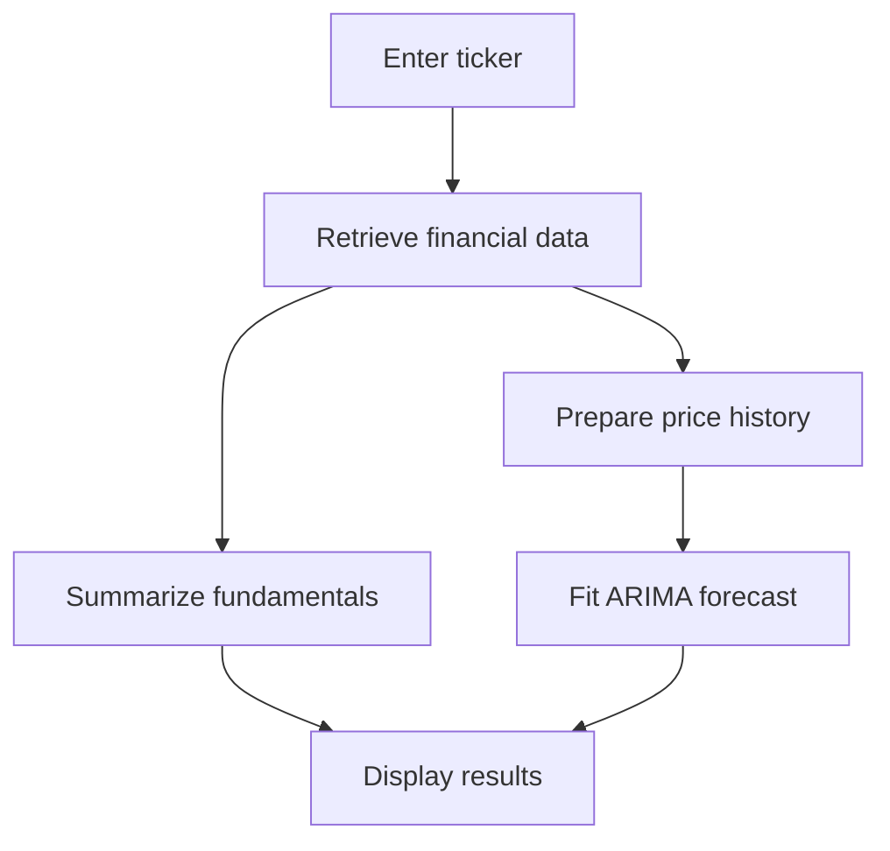

# StockSentinelAI

**A personal Python project for stock research and time-series forecasting.** I built and ran the original Windows desktop prototype, **Quantum Investor Hub**, in June 2025. It combined market data, company fundamentals, and a statistical price forecast in one ticker-analysis workflow.

**Project status:** Personal prototype, documented after the original build. This repository is the engineering case study. The historical source and workbook are currently unavailable, so the original application cannot be run from this repository.

## What I built

1. Enter a ticker and run an analysis in the desktop interface.
2. Retrieve market and company data for the selected ticker.
3. Display the observed price, fundamentals, and beta in the results.
4. Prepare historical prices and generate an ARIMA forecast.

## Recorded Windows run

On **June 9, 2025**, I launched the project with `python quantum_investor_hub.py` and analyzed `GOOG`. The values below are transcribed from the development record.

| Output | Recorded value |
| --- | ---: |
| Stock price | $174.92 |
| Revenue growth | 12% |
| Gross margin | 58.591% |
| Operating cash flow | $132,601,004,032 |
| Beta | 1.014 |
| ARIMA(5,1,0) forecast | $174.11 |

This historical run shows the workflow producing results. The forecast horizon and out-of-sample accuracy were not established in the available record.

## Technical decisions

| Area | Development record |
| --- | --- |
| Runtime and interface | Python on Windows. The historical desktop interface used Tkinter. |
| Market data | Development notes identify Yahoo Finance via `yfinance`. |
| Forecast | The recorded run produced an ARIMA(5,1,0) forecast from historical prices. |
| Visualization | I explored Plotly and debugged plotting imports and GUI threading during development. |
| Other integrations | Google-sourced data, Excel refresh, and OpenAI were part of the broader project work. Their exact behavior in the working build remains unverified. |

I built this to learn how data retrieval, financial calculations, time-series modeling, and a desktop interface fit into a single workflow. The work stayed at the personal prototype stage.

**Built by [Sheldon Mbuh](https://github.com/sheldonmbuh).** This case study documents historical outputs for educational purposes.
