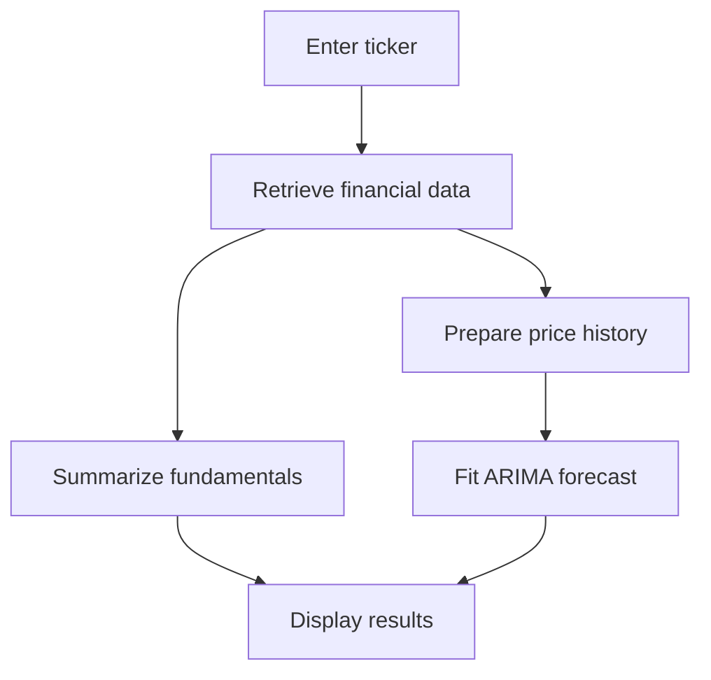

# StockSentinelAI

**A personal Python project for stock research and time-series forecasting.** I built and ran the original Windows desktop prototype, **Quantum Investor Hub**, in June 2025. It combined market data, company fundamentals, and a statistical price forecast in one ticker-analysis workflow.

[**Open the interactive dashboard**](https://sheldonmbuh.github.io/StockSentinelAI/demo/)

The browser demo reconstructs the ticker-entry and results workflow. Enter `GOOG` to replay the archived session or open the model panel for the original Windows launch command.

**Repository status.** The dashboard and Python replay are new implementations of the recorded workflow. The original Tkinter source and Excel workbook are currently unavailable.

## What I built

1. Enter a ticker and run an analysis in the desktop interface.
2. Retrieve market and company data for the selected ticker.
3. Display the observed price, fundamentals, and beta in the results.
4. Prepare historical prices and generate an ARIMA forecast.



## Recorded Windows run

I launched the app on Windows with the command below, entered `GOOG`, and selected **Analyze**. The table records the values shown in the June 9, 2025 development run.

```powershell
python quantum_investor_hub.py
```

| Output | Recorded value |
| --- | ---: |
| Stock price | $174.92 |
| Revenue growth | 12% |
| Gross margin | 58.591% |
| Operating cash flow | $132,601,004,032 |
| Beta | 1.014 |
| ARIMA(5,1,0) forecast | $174.11 |

The run establishes that the app displayed a quote, fundamentals, beta, and a model estimate for one ticker. The forecast horizon and out-of-sample error remain unknown.

## Run the replay locally

From a clone of this repository, use Python 3 to print the recorded session:

```sh
python3 replay.py GOOG
```

To open the dashboard locally, serve the repository and visit `http://localhost:8000/demo/`.

```sh
python3 -m http.server 8000 --bind 127.0.0.1
```

The [dashboard script](demo/dashboard.js) and [Python replay](replay.py) read the same [JSON fixture](demo/recorded-run.json). The estimate-minus-price difference uses integer cents, so the recorded values produce exactly `-$0.81`. The dashboard needs no API keys or build step.

## Technical decisions

| Area | Development record |
| --- | --- |
| Runtime and interface | Python on Windows. The historical desktop interface used Tkinter. |
| Market data | Development notes identify Yahoo Finance via `yfinance`. |
| Forecast | The recorded run produced an ARIMA(5,1,0) forecast from historical prices. |
| Visualization | I explored Plotly and debugged plotting imports and GUI threading during development. |
| Google and Excel | I worked with Google-sourced market data and a refreshing Excel workbook. The data connection and workbook refresh steps still need source-level verification. |
| OpenAI | I experimented with API-assisted news and sentiment analysis. A successful end-to-end run remains unverified. |

## Engineering lessons

- **Desktop plotting.** I encountered Plotly import errors and GUI plotting errors related to thread handling. A reliable rebuild would keep network requests and model fitting off the UI thread and send results back to Tkinter for rendering.
- **Market data preparation.** A Prophet experiment exposed a timezone mismatch in the date column. For any recovered forecasting path, check timestamp normalization, missing observations, and the choice of price series before fitting the model.
- **Optional AI analysis.** One development run reported a news/AI error involving model availability. If that workflow is recovered, verify the actual API response and check that market data and the statistical forecast remain available when the AI call fails.

## Reproducing the original run

The original script and dependency versions are needed to reproduce the Windows run. The Excel workbook is also needed to verify its refresh mechanism and any links to external data.

1. Recover `quantum_investor_hub.py`, its dependencies, and the original workbook. Review source and workbook connections for credentials before sharing any files.
2. Run the ticker workflow on Windows and record the data source, price series, training window, model settings, and forecast horizon.
3. Evaluate the forecast at that horizon with rolling historical splits. Compare its error with a baseline that uses the last observed price.

**Built by [Sheldon Mbuh](https://github.com/sheldonmbuh).** This case study documents historical outputs for educational purposes.
